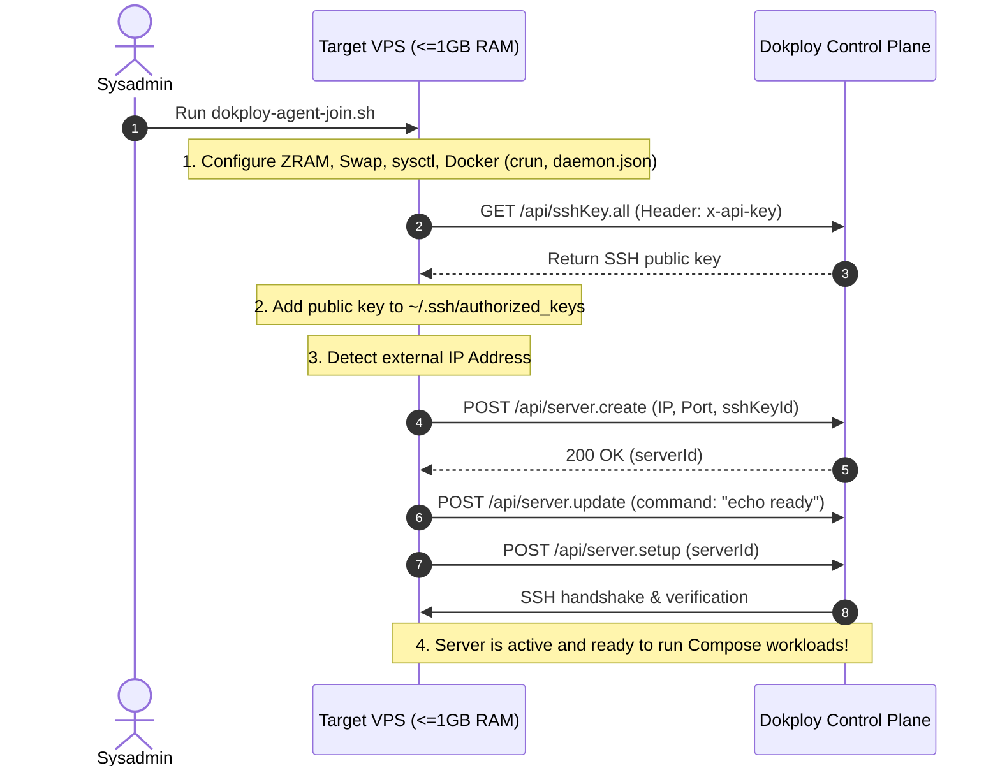

# Server Setup 🚀

> **Lightweight Linux & Docker Node Provisioning Toolkit with Control Plane Auto-Enrollment.**  
> Turn budget VPS instances (<= 1 GB RAM, 1 vCPU) into lean, robust Docker worker nodes consuming only **~90–110 MB idle RAM**.

---

## 💡 The Problem

Modern self-hosted PaaS panels (like **Dokploy**, Coolify, and others) are great, but their default remote node setup is often heavyweight:
- Automatically initializes **Docker Swarm mode** (raft consensus, swarm overlay).
- Runs an in-node **Traefik Ingress** container (consuming 60–100 MB RAM).
- Installs multi-gigabyte build tools (Nixpacks, Buildpacks, Railpack).
- Deploys continuous monitoring scrapers (Vector, cAdvisor, Node Exporter).

On budget cloud VPS servers ($3–$5/month with 512 MB – 1 GB RAM), this default stack consumes **450–550 MB RAM** just idling. Pulling a multi-layer container image (`docker pull`) on a single vCPU causes catastrophic **OOM (Out-of-Memory)** crashes.

## 🎯 The Solution

**`server-setup`** provides a zero-dependency, production-tested toolkit to:
1. **Slash Idle Memory by 80%**: Run Docker with `crun` and optimized `daemon.json`, keeping total OS + Docker idle footprint under **~100 MB RAM**.
2. **Eliminate OOM Crashes**: Tiered memory protection with in-memory **ZRAM (LZ4)** and fallback SSD swapfile.
3. **One-Command Auto-Enrollment (`Agent Join`)**: Run one command on the new server. It optimizes the machine, pulls your panel's SSH public key, adds it to `authorized_keys`, and registers the server into Dokploy via API with **zero manual clicks in the UI**.
4. **100% Upstream Compatible**: Requires **0 changes or patches** to Dokploy. Works with official upstream releases.

---

## 📊 Memory Footprint Comparison

| Component | Default Node | With `server-setup` | Savings |
| :--- | :--- | :--- | :--- |
| **Linux OS Baseline** | ~70 MB | ~50 MB | Caps journald, cleans services |
| **`dockerd`** | ~90 MB | **~40 MB** | BuildKit off, `GOMEMLIMIT=128MiB` |
| **`containerd`** | ~45 MB | **~18 MB** | CRI disabled, tuned GC |
| **`docker-proxy`** | ~10 MB / port | **0 MB** | Native kernel iptables/nftables |
| **Container Shims** | ~20 MB / container (`runc`) | **2–4 MB** (`crun`) | C-based OCI runtime |
| **Docker Swarm Mode** | ~75 MB | **0 MB** | Standalone Compose mode |
| **Traefik Ingress** | ~80 MB | **0 MB** | External routing / Direct ports |
| **Vector / cAdvisor** | ~100 MB | **0 MB** | Lightweight SSH polling |
| **TOTAL Idle RAM** | **~450–550 MB** | **~90–110 MB** | **🔥 ~400+ MB freed for your apps!** |

---

## ⚡ Quick Start

### Mode A: Auto-Join to Dokploy (Reverse Registration)

Log in to your target server via SSH and run:

```bash
curl -sSL https://raw.githubusercontent.com/littfed/server-setup/main/scripts/dokploy-agent-join.sh | sudo bash -s -- \
  --dokploy-url https://dokploy.example.com \
  --api-key dkp_your_api_key_here \
  --name "worker-node-01"
```

What happens automatically:
1. Tunes kernel, sets up ZRAM + swapfile, installs Docker with `crun`.
2. Connects to Dokploy API (`/api/sshKey.all`) and fetches your Dokploy instance's public SSH key.
3. Authorizes the key in `~/.ssh/authorized_keys`.
4. Detects public IP and calls `POST /api/server.create` and `POST /api/server.setup`.
5. **The node instantly appears active and green in your Dokploy dashboard!**

---

### Mode B: Standalone Low-RAM Server Optimization

If you want to prepare any Linux VPS to run Docker with minimal memory consumption (without Dokploy):

```bash
curl -sSL https://raw.githubusercontent.com/littfed/server-setup/main/scripts/lightweight-worker-setup.sh | sudo bash
```

Or paste it into the **Custom Setup Command** field in the Dokploy UI when manually adding a server.

---

## 🛠 Architecture & How It Works



---

## 📂 Repository Structure

```
server-setup/
├── scripts/
│   ├── dokploy-agent-join.sh      # One-click auto-registration agent
│   ├── lightweight-worker-setup.sh# Low-RAM Docker and Linux tuner
│   └── README.md                  # Script documentation
├── research/
│   ├── 01-remote-deployment-mechanics.md # Dokploy Swarm & Compose analysis
│   ├── 02-traefik-coupling.md            # Traefik decoupling evidence
│   └── 03-docker-engine-low-ram.md       # Linux & Docker kernel benchmarks
├── docs/
│   ├── adr/
│   │   └── 0001-lightweight-remote-server-profile.md
│   └── agents/                    # SDD / Matt Pocock workflow rules
├── GLOSSARY.md                    # Domain language
├── CLAUDE.md                      # AI Assistant steering rules
├── LICENSE                        # MIT License
└── README.md
```

---

## 🗺 Roadmap & Ideas to Expand

- [x] Auto-enrollment agent for Dokploy (`dokploy-agent-join.sh`).
- [x] Docker + `crun` low-RAM profile under 110 MB RAM.
- [ ] **Multi-Panel Support**: Adapters for Coolify and Portainer auto-enrollment.
- [ ] **Lightweight Ingress**: Built-in optional Cloudflare Tunnel (`cloudflared`) or Caddy micro-proxy for direct HTTPS termination without Traefik.
- [ ] **Auto-Prune Daemon**: Safe, low-priority Docker garbage collection cron for small disks (10–20 GB SSD).
- [ ] **Zero-overhead Healthchecks**: Micro-daemon or cron reporter streaming stats without cAdvisor.

---

## 📄 License

MIT © [littfed](https://github.com/littfed)
