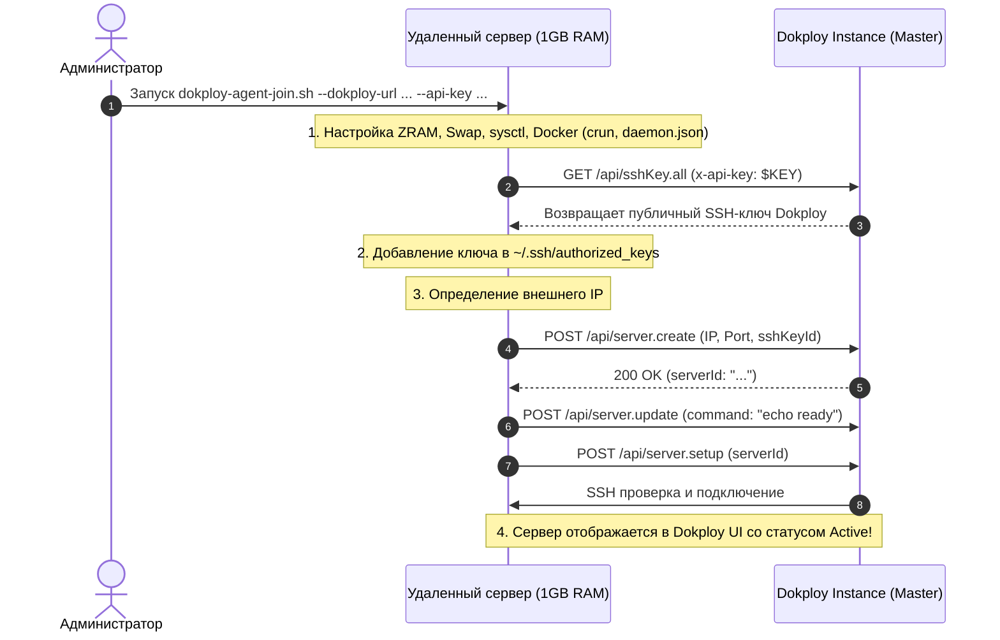

# Dokploy Lightweight Node Agent (`dokploy-agent-join.sh`)

Скрипт для подключения любого Linux-сервера (включая микро-VPS с 512 МБ – 1 ГБ RAM) к Dokploy **в один шаг с целевого сервера**, без модификации исходного кода Dokploy.

## Как это работает



## Требования
1. Dokploy запущен (любая официальная версия Dokploy).
2. Создан API-ключ в Dokploy (**User Profile** ➔ **API Keys** ➔ **Create API Key**).
3. В Dokploy есть хотя бы один SSH-ключ (**Settings** ➔ **SSH Keys**).

## Запуск на новом сервере

Подключитесь по SSH к новому серверу и выполните одну команду:

```bash
curl -sSL https://raw.githubusercontent.com/.../dokploy-agent-join.sh | sudo bash -s -- \
  --dokploy-url https://dokploy.example.com \
  --api-key dkp_your_api_key_here \
  --name "node-worker-01"
```

### Параметры:
- `--dokploy-url`: URL вашего инстанса Dokploy (обязательно).
- `--api-key`: API ключ пользователя Dokploy (обязательно).
- `--name`: Имя сервера в дашборде Dokploy (по умолчанию: текущий hostname).
- `--port`: SSH порт целевого сервера (по умолчанию: 22).
- `--user`: SSH пользователь (по умолчанию: текущий пользователь).
- `--ssh-key-id`: ID конкретного ключа в Dokploy (если не указан, берется первый активный).

## Итог
- Сервер автоматически оптимизирован (базовый простой **~90–110 МБ RAM**).
- Ключ Dokploy автоматически добавлен в `~/.ssh/authorized_keys`.
- Сервер зарегистрирован и верифицирован в Dokploy.
- В Dokploy UI сервер сразу доступен для деплоя Compose-проектов.
